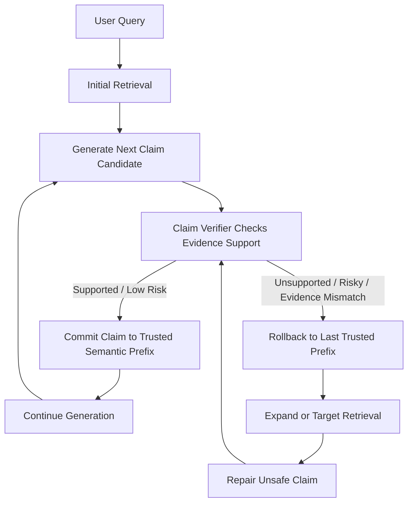
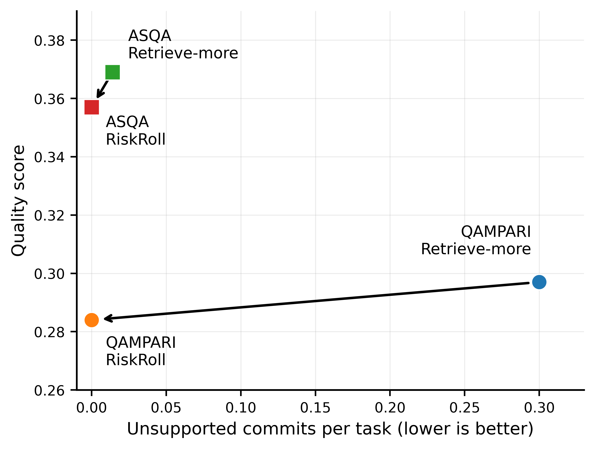

# RiskRoll-RAG

## Core Idea

RiskRoll uses a simple principle:

> **Verify before commit.**

For every candidate semantic unit:

1. Generate a candidate claim.
2. Check whether retrieved evidence supports it.
3. If supported, commit it to the trusted prefix.
4. If unsupported, rollback.
5. Expand retrieval.
6. Attempt localized repair.
7. Abstain if no supported repair can be found.

This prevents unsupported claims from becoming conditioning context for future generation.

---

## RiskRoll Workflow



The important difference from standard RAG is the **commitment boundary**.

A candidate claim is not automatically allowed to influence future generation.

---

# Method

Let a long-form answer contain semantic units:

$$
C = (c_1, c_2, \ldots, c_T)
$$

In conventional RAG:

$$
\hat{c}_t \sim G(q, E_k(q), \hat{C}_{<t})
$$

where:

- \(q\) is the user query,
- \(E_k(q)\) is the retrieved evidence,
- \(\hat{C}_{<t}\) is the already generated prefix.

The problem is that the prefix may contain unsupported claims.

RiskRoll instead maintains a trusted semantic state:

$$
S_t
$$

A candidate claim is generated as:

$$
\tilde{c}_t \sim G(q, E_{k_i}(q), S_t)
$$

A verifier evaluates:

$$
V(\tilde{c}_t, E_{k_i}(q)) \in \{0,1\}
$$

If supported:

$$
S_{t+1} = S_t \oplus \tilde{c}_t
$$

If unsupported:

$$
S_{t+1} = S_t
$$

The rejected candidate never becomes part of the trusted generation state.

---

# Rollback and Repair

If a claim fails verification, RiskRoll does not rewrite the entire answer.

Instead, it performs **localized recovery**.

```text
Unsupported Claim
       ↓
Rollback
       ↓
Deeper / Targeted Retrieval
       ↓
Regenerate Unsafe Semantic Unit
       ↓
Verify Again
       ↓
Commit or Abstain
```

The retrieval-depth schedule used in the public experiments was:

```text
K = (1, 5, 10, 20)
```

This allows RiskRoll to spend additional inference-time computation only when a claim fails verification.

---

# Experiments

RiskRoll was evaluated in three settings.

### 1. Controlled Near-Miss Stress Test

A controlled benchmark was designed where plausible but incorrect evidence appears above correct evidence.

The goal was to test whether systems allow unsupported information to enter the generation state.

Compared systems included:

- Standard RAG
- Retrieve-More RAG
- Post-Hoc Correction
- CRAG-style Correction
- RiskRoll-RAG

---

### 2. Noisy Verifier Experiments

RiskRoll depends on a verifier, so we explicitly study verifier failure.

Two error types are evaluated:

```text
False Accept
Unsupported claim is incorrectly accepted
        ↓
Unsafe claim enters trusted prefix


False Reject
Supported claim is incorrectly rejected
        ↓
Extra rollback / abstention
```

The experiments show an important asymmetry:

> False accepts are more harmful because they contaminate the generation state.

False rejects primarily reduce completeness.

---

### 3. Public ALCE Benchmarks

RiskRoll was evaluated using:

- **ALCE-QAMPARI**
- **ALCE-ASQA**
- **Qwen2.5-7B-Instruct**

For ASQA:

```text
73 usable tasks
222 evaluated claim-level units
```

---

# Main Results

## ALCE-QAMPARI

| Method | Answer F1 | Strict Grounded | Support | Unsupported Commits |
|---|---:|---:|---:|---:|
| Standard RAG | 0.145 | 0.112 | 0.768 | 0.090 |
| Retrieve-More | 0.297 | 0.244 | 0.873 | 0.300 |
| Post-Hoc | 0.227 | 0.182 | 0.937 | 0.110 |
| CRAG-style | 0.273 | 0.216 | 0.828 | 0.350 |
| **RiskRoll** | **0.284** | **0.268** | **0.990** | **0.000** |

RiskRoll retains approximately **95.6% of Retrieve-More Answer F1** while increasing strict grounded quality and eliminating measured unsupported commits under the explicit verifier.

---

## ALCE-ASQA

| Method | Claim Accuracy | Support | Unsupported Commits |
|---|---:|---:|---:|
| Standard RAG | 0.158 | 0.452 | 0.000 |
| Retrieve-More | 0.369 | 0.801 | 0.014 |
| Post-Hoc | 0.097 | 0.301 | 0.000 |
| CRAG-style | 0.292 | 0.740 | 0.014 |
| **RiskRoll** | **0.357** | **0.877** | **0.000** |

RiskRoll retains approximately **96.7% of Retrieve-More claim accuracy** while improving evidence support.

---

## Safety-Quality Tradeoff



RiskRoll moves the system toward lower measured contamination while preserving similar task-level answer quality.

---

# Verifier Sensitivity

One of the most important RiskRoll observations is the difference between false accepts and false rejects.

```text
False Accept
      ↓
Unsupported state update
      ↓
Future generation sees false prefix
      ↓
Potential contamination


False Reject
      ↓
Supported claim rejected
      ↓
Repair / abstention
      ↓
Lower recall but clean prefix
```

This motivates conservative commitment control.

---

# Causal Interpretability Extension

RiskRoll asks:

> **How can we prevent unsupported claims from entering the generation state?**

The interpretability extension asks:

> **What happens when an unsupported factual claim enters the state anyway?**

The goal is to study whether a naturally generated factual error changes the model's subsequent use of correct retrieved evidence.

---

## Research Question

The current extension investigates the following causal chain:

```text
Natural RAG generation
        ↓
Model naturally makes factual error
        ↓
Correct retrieval is still available
        ↓
False statement remains in model's own history
        ↓
Later factual decision
        ↓
Does the model still use retrieval correctly?
```

The key experimental design uses a matched counterfactual.

---

## Natural vs Corrected Prefix Experiment

For a naturally occurring factual error:

### Condition A

```text
Natural incorrect prefix
+
same retrieved evidence
+
same model
+
same decoding
```

### Condition B

```text
Minimally corrected prefix
+
same retrieved evidence
+
same model
+
same decoding
```

Only the earlier factual span changes.

This allows us to ask whether the earlier self-generated error has a causal downstream effect.

---

# Example: Friday Night Lights

Question:

```text
Who wins at the end of Friday Night Lights?
```

Natural model prefix:

```text
In the film adaptation of "Friday Night Lights,"
Permian High School's football team wins the
championship game against their rivals,
securing the state title.
```

Retrieved evidence states that **Dallas Carter wins the championship**.

Minimal counterfactual:

```text
In the film adaptation of "Friday Night Lights,"
Dallas Carter High School's football team wins
the championship game against their rivals,
securing the state title.
```

The downstream generations differ substantially.

This provides an initial causal-behavioral example where modifying only the earlier factual error changes the later generation trajectory.

---

# Additional Pilot Cases

### Champions League 2018

Natural generation:

```text
Doja Cat performed at the opening ceremony...
```

Corrected prefix:

```text
Dua Lipa performed at the opening ceremony...
```

The selected prefix already completed the response, leaving no useful downstream continuation window.

This case is therefore not used as a strong propagation example.

---

### Baby's Day Out

Natural prefix:

```text
Brian Haley played the role of Baby Bink.
```

The model subsequently mentions the Worton twins correctly.

This provides a useful **self-recovery control**.

Not every factual error necessarily propagates.

---

# Mechanistic Interpretability

Behavioral differences alone do not identify a mechanism.

The next stage studies which internal model components mediate the effect.

The planned causal analysis includes:

```text
Natural false prefix
        ↓
Different downstream factual preference
        ↓
Layer-level activation patching
        ↓
Attention vs MLP localization
        ↓
Candidate information-routing components
        ↓
Targeted internal intervention
```

---

## Activation Patching

For a natural-error / corrected-prefix pair:

1. Run the corrected-prefix condition.
2. Record internal activations.
3. Run the natural-error condition.
4. Replace selected internal activations with their corrected-prefix counterparts.
5. Measure whether evidence-supported factual behavior recovers.

Conceptually:

$$
\text{False Prefix}
\rightarrow
\text{Wrong Evidence Preference}
$$

then:

$$
\text{False Prefix}
+
\text{Patched Internal State}
\rightarrow
\text{Recovered Evidence Preference}
$$

A successful patch suggests that the patched component causally mediates part of the behavioral difference.

---

# Evidence-Use Metric

For each downstream factual decision, we compare the model's preference for the evidence-supported answer against the answer that is consistent with the false prefix.

We define the evidence-use margin as:

$$
M = \ell_{\text{evidence}} - \ell_{\text{false-prefix}}
$$

where:

- $\ell_{\text{evidence}}$ is the model score for the answer supported by the retrieved evidence.
- $\ell_{\text{false-prefix}}$ is the model score for the answer that remains consistent with the incorrect generated prefix.

A larger value of $M$ indicates stronger preference for the retrieved evidence, while a smaller or negative value indicates stronger influence from the false prefix.

To measure the causal effect of correcting the earlier factual error, we compute:

```math
\Delta =
\left(
\ell_{\mathrm{evidence}} - \ell_{\mathrm{false\text{-}prefix}}
\right)_{\mathrm{corrected}}
-
\left(
\ell_{\mathrm{evidence}} - \ell_{\mathrm{false\text{-}prefix}}
\right)_{\mathrm{natural}}
```

where:

- **Natural condition:** uses the original self-generated factual error.
- **Corrected condition:** changes only the erroneous factual span while keeping the remaining context fixed.

Interpretation:

- $\Delta > 0$: correcting the earlier error increases preference for the retrieved evidence.
- $\Delta \approx 0$: correcting the earlier error has little downstream effect.
- $\Delta < 0$: correcting the earlier error decreases preference for the retrieved evidence.
---

# Internal Intervention

A stronger test keeps the false sentence unchanged.

Instead of rewriting the prefix:

```text
False textual prefix remains
        +
Internal activation intervention
        ↓
Does the model return to evidence-supported behavior?
```

This separates:

```text
textual correction
```

from:

```text
internal causal restoration
```

The long-term objective is to identify an internal pathway responsible for the effect of self-generated factual history on retrieved-evidence use.

---

# Research Connection

The two parts of this repository are complementary.

```text
RiskRoll-RAG
"What should we do BEFORE an unsupported claim
enters the generation state?"

                    ↓

Causal Analysis
"What changes AFTER an unsupported claim
enters the generation state?"

                    ↓

Mechanistic Interpretability
"Which internal computation carries that effect?"

                    ↓

Intervention
"Can we restore correct evidence use without
rewriting the false prefix?"
```

---

# Repository Structure

```text
riskroll-rag-safety-and-interpretability/
│
├── README.md
├── requirements.txt
├── .gitignore
│
├── legacy_riskroll/
│   │
│   ├── src/
│   ├── experiments/
│   ├── scripts/
│   ├── data/
│   ├── results/
│   └── paper_assets/
│
├── causal_analysis/
│   │
│   ├── natural_generation/
│   │
│   ├── validated_errors/
│   │
│   ├── prefix_counterfactuals/
│   │   ├── pilot_cases.json
│   │   └── run_prefix_counterfactual.py
│   │
│   └── mechanistic_analysis/
│
├── notebooks/
│   └── 01_natural_error_causal_prefix_pilot.ipynb
│
├── results/
│   │
│   ├── riskroll/
│   │
│   └── causal_prefix/
│
├── figures/
│   ├── riskroll_public_tradeoff.png
│   └── false_accepts_reduce_grounding.png
│
└── docs/
    ├── diagrams.md
    ├── literature_review_and_gap_analysis.md
    └── research_roadmap.md
```

---

# Installation

Clone the repository:

```bash
git clone https://github.com/<YOUR_USERNAME>/riskroll-rag-safety-and-interpretability.git

cd riskroll-rag-safety-and-interpretability
```

Create an environment:

```bash
python -m venv .venv
source .venv/bin/activate
```

Install dependencies:

```bash
pip install -r requirements.txt
```

---

# Model

The main experiments use:

```text
Qwen2.5-7B-Instruct
```

Large model weights and Hugging Face caches are intentionally not included in the repository.

Configure the model path locally before running experiments.

Example:

```python
MODEL_PATH = "/path/to/Qwen2.5-7B-Instruct"
```

---

# Running the Prefix Counterfactual Experiment

Example:

```bash
python causal_analysis/prefix_counterfactuals/run_prefix_counterfactual.py \
  --input-jsonl /path/to/asqa_qwen7b_natural_longform_full73_top3.jsonl \
  --model-path /path/to/Qwen2.5-7B-Instruct \
  --cases causal_analysis/prefix_counterfactuals/pilot_cases.json \
  --output results/causal_prefix/natural_vs_corrected_prefix_pilot.json
```

---

# Evaluation Metrics

RiskRoll uses several contamination-oriented metrics.

### Unsupported Commits

Number of unsupported semantic units allowed into the generation state.

### Unsafe-Prefix Depth

Number of downstream generation steps exposed to a contaminated state.

### Clean Task Rate

Fraction of tasks with no unsupported committed claims.

### Evidence Support Rate

Fraction of generated non-abstained units supported by retrieved evidence under the explicit verifier.

### Answer Quality

Dataset-specific answer quality:

```text
QAMPARI → Answer F1
ASQA    → Claim Accuracy
```

---

# Important Evaluation Note

The public ALCE experiments use a deterministic lexical support checker.

The same verifier is used for RiskRoll commitment decisions and verifier-supported safety measurements.

Therefore:

> **Zero unsupported commits means zero violations under the explicit verifier.**

It should not be interpreted as perfect semantic correctness under an independent human or neural entailment evaluator.

---

# Limitations

The current RiskRoll evaluation has several limitations.

### Verifier Quality

A lexical verifier may fail on:

- paraphrases,
- numerical reasoning,
- non-extractive synthesis,
- semantically equivalent statements.

### Model Coverage

The main public experiments use:

```text
Qwen2.5-7B-Instruct
```

Testing additional model families would strengthen generality.

### Benchmark Scale

The reported public experiments contain:

```text
100 QAMPARI tasks
73 ASQA tasks
```

Larger-scale evaluation would provide stronger statistical evidence.

### Safety vs Completeness

RiskRoll may abstain when it cannot find a supported repair.

This improves conservative grounding but may reduce recall.

---

# Current Research Direction

The next experiments focus on three questions.

### RQ1 — Behavioral Causality

Does correcting a naturally generated factual error change later use of already-present correct evidence?

### RQ2 — Mechanism

Which internal components mediate the influence of the false self-generated prefix?

### RQ3 — Intervention

Can the evidence-supported behavior be restored internally while the false sentence remains unchanged?

---

# Project Status

### RiskRoll-RAG

```text
Completed
```

Includes:

- RiskRoll controller
- rollback and repair
- verifier analysis
- controlled stress tests
- QAMPARI evaluation
- ASQA evaluation
- ablation analysis
- uncertainty analysis
- generated figures and tables

### Causal Interpretability Extension

```text
Active extension
```

Completed so far:

- continuous long-form ASQA generation
- natural error mining
- manually validated natural-error cases
- natural vs corrected prefix counterfactual pilot

Current experiments:

- evidence-supported logit margins
- layer-level activation patching
- attention / MLP causal localization
- internal restoration while retaining the false prefix

---

# Key Takeaway

RiskRoll treats factuality as more than a final-answer evaluation problem.

The central idea is:

> **A generated claim should not become part of the model's trusted generation state until it has been verified against evidence.**

The interpretability extension takes the next step:

> **If an incorrect claim does enter that state, what internal mechanism causes it to influence later evidence use?**

Together, the two directions connect:

```text
RAG Safety
+
Long-Form Factuality
+
Inference-Time Control
+
Causal Analysis
+
Mechanistic Interpretability
```

---

# License

Add the appropriate license before public release.

For example:

```text
MIT License
```

or another license appropriate for the research code and associated data.

---

## Contact

For questions, collaboration, or research discussion:

```text
Kaushik Joshi
M.S. Artificial Intelligence
Boston University
```
```
