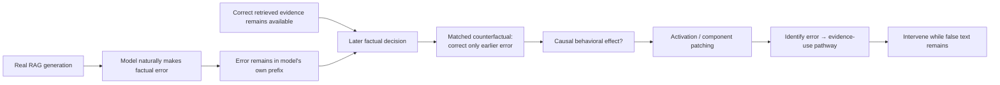

# Literature Review and Gap Analysis: How Self-Generated Factual Errors Alter Evidence Use in RAG

## Executive summary

I reviewed the literature against the three questions in your research statement: whether an earlier self-generated factual error changes later use of correct retrieval (**RQ1**), what internal mechanism carries that effect (**RQ2**), and whether an internal intervention can restore evidence use while the false text remains in context (**RQ3**).

### Bottom-line verdict

**The exact core question is not already solved, but the novelty window is narrower than it first appears.**

Several pieces are already known:

- Models can prefer **generated context over retrieved context when the two conflict**. Tan et al. directly established this behavior in 2024. Therefore, “models trust generated text over retrieval” is **not** a novel finding by itself.
- Long-form factuality does **not automatically deteriorate because earlier errors propagate**. Zhao et al. explicitly tested error propagation and found “facts exhaustion” to be the dominant explanation in their experiments. This is an important competing hypothesis for our RQ1.
- Context-vs-parametric-memory conflicts already have substantial mechanistic work. Jin et al. causally identified competing context and memory attention heads; ReDeEP separates external-context use from parametric knowledge; SpARE finds steerable mid-layer conflict representations; and CoDA identifies and manipulates evidence-routing behavior in RAG.
- Retrieval itself has already been mechanistically localized: Wu et al. identify sparse “retrieval heads,” and pruning them causes retrieval failure and hallucination.
- By 2026, there is also very close work on **self-generated errors themselves**. Petrova and Vejsiu's SPARC preprint studies a “self-correction blind spot” in which models struggle more with their own errors than externally attributed errors and proposes an attention-Jacobian theory of autoregressive error propagation. However, it is **not a RAG study of correct retrieved evidence competing with a naturally generated factual error**, nor is its central experiment the natural-error/corrected-prefix RAG counterfactual we are proposing.

What I **did not find in the primary literature searched through September 27, 2026** is a study that puts all of the following together:



That chain is the defensible gap. This is a **search-based conclusion, not a claim that no paper anywhere could exist**. The nearest papers each cover one or two pieces, but not the complete natural self-error → later retrieval-use → causal localization → intervention story.

My assessment is therefore:

| Question | Novelty status | Risk |
|---|---|---|
| **RQ1: Does a natural self-generated error alter later use of correct retrieval?** | **Still open enough**, if based on natural same-response errors and matched correction | Medium |
| **RQ2: What internal mechanism carries that influence?** | **Promising**, but must distinguish it from existing retrieval/context-memory mechanisms | Medium-high |
| **RQ3: Can the pathway be selectively interrupted?** | **Potentially strongest contribution** | High reward, high technical risk |
| “Generated context can override retrieval” | **Already done** | Do not claim |
| “Certain heads/layers matter for retrieval” | **Already done** | Do not claim |
| “RAG hallucination is context-vs-memory competition” | **Already substantially studied** | Do not claim as new |
| “Earlier errors always propagate” | **Not established; evidence cuts against a universal claim** | Must test |

The six papers I would read **before writing code or claiming novelty** are, in order:

1. [Tan et al. — *Blinded by Generated Contexts*](https://aclanthology.org/2024.acl-long.337/)
2. [Sun et al. — *ReDeEP*](https://proceedings.iclr.cc/paper_files/paper/2025/hash/7daf60e805e596c3bd1e843e72ea5560-Abstract-Conference.html)
3. [Jin et al. — *Cutting Off the Head Ends the Conflict*](https://aclanthology.org/2024.findings-acl.70/)
4. [Zhao et al. — *How Does Response Length Affect Long-Form Factuality*](https://aclanthology.org/2025.findings-acl.161/)
5. [Wu et al. — *Retrieval Head Mechanistically Explains Long-Context Factuality*](https://proceedings.iclr.cc/paper_files/paper/2025/hash/9b77f07301b1ef1fe810aae96c12cb7b-Abstract-Conference.html)
6. [Shi et al. — *CoDA*](https://aclanthology.org/2026.findings-acl.576/)

Those six tell us, respectively: **the closest behavioral overlap, the closest mechanistic RAG overlap, the closest causal conflict overlap, the strongest challenge to error propagation, the retrieval-head mechanism, and the latest mechanism-based RAG intervention.**

## Prioritized literature map

The papers below are ordered roughly by how important they are for deciding whether this project survives review. “RQ1/RQ2/RQ3” refer to the questions in your research statement.

### RAG and generated-context or evidence conflicts

**Priority A1 — Hexiang Tan, Fei Sun, Wanli Yang, Y. Wang, Q. Cao, and X. Cheng. 2024. “Blinded by Generated Contexts: How Language Models Merge Generated and Retrieved Contexts When Knowledge Conflicts?” ACL 2024.** [Primary source](https://aclanthology.org/2024.acl-long.337/)

This is the single most important overlap. Tan et al. explicitly put **generated context and retrieved context into conflict** and find that GPT-4/3.5 and Llama-2 models often favor generated information even when it is wrong; they also identify factors such as similarity to the question and semantic completeness that affect the preference. This preempts any claim that “generated text can dominate retrieval” is itself new, but it does **not** provide a causal component-level explanation of a naturally generated earlier error inside the same response. **Informs RQ1 strongly; motivates RQ2/RQ3.**

Their limitations explicitly leave broader and more complex conflict configurations open, including multiple contexts, and they do not provide an internal mechanism-based mitigation.

**Priority A2 — Cheng Niu, Yuanhao Wu, Juno Zhu, Siliang Xu, KaShun Shum, Randy Zhong, Juntong Song, and Tong Zhang. 2024. “RAGTruth: A Hallucination Corpus for Developing Trustworthy Retrieval-Augmented Language Models.” ACL 2024.** [Primary source](https://aclanthology.org/2024.acl-long.585/)

RAGTruth contains nearly **18,000 naturally generated RAG responses** with manual hallucination annotations at case and word level. It does not study temporal propagation or mechanisms, but it is important because it proves that a serious experiment need not manufacture every hallucination synthetically; naturally occurring RAG errors can be mined and independently labeled. **Informs RQ1 and experimental design.**

No explicit future-work statement central to our question was located on the primary page; the open opportunity is temporal/causal analysis of those natural hallucinations rather than static detection.

**Priority A3 — Mingda Chen, Yang Li, Karthik Padthe, Rulin Shao, Alicia Yi Sun, Luke Zettlemoyer, Gargi Ghosh, and Wen-tau Yih. 2025. “Improving Factuality with Explicit Working Memory.” ACL 2025.** [Primary source](https://aclanthology.org/2025.acl-long.548/)

Ewe gives long-form generation an explicit working memory updated with online fact-checking and retrieval feedback. It improves factuality across four fact-seeking long-form datasets, showing that **how previous information is retained or updated during generation matters**; however, it is a system-level correction mechanism, not a causal analysis of how a false self-prefix changes transformer computation. **Informs RQ1 and RQ3.**

The practical lesson for us is important: simply inventing another external “verify/update memory” method would face strong overlap with Ewe. Our differentiator needs to be the **internal causal mechanism**, not merely another correction loop.

**Priority A4 — Jungyeon Lee, Lee Kangmin, and Taeuk Kim. 2025. “MAGIC: A Multi-Hop and Graph-Based Benchmark for Inter-Context Conflicts in Retrieval-Augmented Generation.” Findings of EMNLP 2025.** [Primary source](https://aclanthology.org/2025.findings-emnlp.466/)

MAGIC broadens RAG knowledge-conflict evaluation beyond simple entity substitutions and shows that models struggle to detect subtle conflicts, especially when multi-hop reasoning is required. Its conflicts are primarily between retrieved contexts or retrieved content and parametric knowledge, not the model's own naturally generated history. **Informs RQ1/RQ2 as an important control setting.**

The paper explicitly positions its analyses as a foundation for improving how models integrate “diverse, sometimes even conflicting, information,” leaving mechanism-specific conflict resolution open.

**Priority A5 — Alex Mallen, Akari Asai, Victor Zhong, Rajarshi Das, Daniel Khashabi, and Hannaneh Hajishirzi. 2023. “When Not to Trust Language Models: Investigating Effectiveness of Parametric and Non-Parametric Memories.” ACL 2023.** [Primary source](https://aclanthology.org/2023.acl-long.546/)

Mallen et al. study when parametric memory succeeds or fails relative to retrieved/non-parametric memory and use those findings to retrieve selectively. This is foundational for separating **model memory vs retrieval**, but it does not introduce self-generated history as a third source. **Informs RQ2 and the necessary parametric-memory control.**

**Priority A6 — Zhengbao Jiang, Frank Xu, Luyu Gao, Zhiqing Sun, Qian Liu, Jane Dwivedi-Yu, Yiming Yang, Jamie Callan, and Graham Neubig. 2023. “Active Retrieval Augmented Generation.” EMNLP 2023.** [Primary source](https://aclanthology.org/2023.emnlp-main.495/)

FLARE argues that one-shot retrieval is insufficient for long-form generation and retrieves repeatedly based on predicted upcoming content and model confidence. It is relevant because it treats long generation as a **sequential information-acquisition process**, but it does not ask what a previous false statement does internally after it is committed. **Informs RQ1/RQ3 context, but is not a direct overlap.**

**Priority A7 — Akari Asai, Zeqiu Wu, Yizhong Wang, Avi Sil, and Hannaneh Hajishirzi. 2024. “Self-RAG: Learning to Retrieve, Generate, and Critique through Self-Reflection.” ICLR 2024.** [Primary source](https://proceedings.iclr.cc/paper_files/paper/2024/hash/25f7be9694d7b32d5cc670927b8091e1-Abstract-Conference.html)

Self-RAG trains a model to retrieve adaptively and critique its own generations with reflection tokens. It demonstrates that retrieval and self-evaluation can be integrated into generation, but it does not causally trace how an already-generated false factual span changes later use of evidence. **Informs RQ3 and establishes a strong systems baseline.**

**Priority A8 — Zhepei Wei, Wei-Lin Chen, and Yu Meng. 2025. “InstructRAG: Instructing Retrieval-Augmented Generation via Self-Synthesized Rationales.” ICLR 2025.** [Primary source](https://proceedings.iclr.cc/paper_files/paper/2025/hash/cdce0de17dc3cf97019a35baa65aebd0-Abstract-Conference.html)

InstructRAG trains models to explicitly reason about noisy retrieved documents using self-synthesized rationales and reports improved robustness over several knowledge-intensive benchmarks. Its noise originates in retrieval, rather than in the model's own earlier generated statement, so it helps delineate the difference between **bad evidence** and **bad self-history**. **Informs RQ1/RQ3 controls.**

**Priority A9 — Patrick Lewis, Ethan Perez, Aleksandra Piktus, Fabio Petroni, Vladimir Karpukhin, Naman Goyal, Heinrich Küttler, Mike Lewis, Wen-tau Yih, Tim Rocktäschel, Sebastian Riedel, and Douwe Kiela. 2020. “Retrieval-Augmented Generation for Knowledge-Intensive NLP Tasks.” NeurIPS 2020.** [Primary source](https://proceedings.neurips.cc/paper/2020/hash/6b493230-Abstract.html)

This is the foundational RAG paper: parametric generation is coupled to non-parametric retrieved memory. Its importance here is conceptual: our project effectively adds a **third information source**, self-generated history, to the classic parametric-vs-retrieved picture. **Background for RQ1/RQ2.**

The paper explicitly identifies updating and manipulating world knowledge as open problems, but predates the modern question of self-generated factual context.

### Long-form hallucination and error propagation

**Priority B1 — James Xu Zhao, Jimmy Z. J. Liu, Bryan Hooi, and See-Kiong Ng. 2025. “How Does Response Length Affect Long-Form Factuality.” Findings of ACL 2025.** [Primary source](https://aclanthology.org/2025.findings-acl.161/)

This is the most important paper that can **kill an overly broad version of our hypothesis**. Zhao et al. experimentally compare error propagation, long-context effects, and facts exhaustion; in their setup, facts exhaustion—not error propagation—is the primary explanation for declining factual precision in longer outputs. Therefore, our paper cannot assume that an earlier hallucination necessarily poisons later claims. **Directly informs/challenges RQ1.**

Their future-work discussion calls for broader model coverage, improved factuality metrics, and deeper study of how internal knowledge is used or exhausted.

**Priority B2 — Ingrid Petrova and Luan Vejsiu. 2026. “Spectral Origins of the Self-Correction Blind Spot in Autoregressive Generation.” arXiv:2607.09803.** [Primary source](https://arxiv.org/abs/2607.09803)

This is a **very important new overlap**. The authors argue that autoregressive models exhibit a self-correction blind spot: an identical mistake can be easier to correct when attributed externally than when it is the model's own output, and they model propagation through products of attention Jacobians. They validate the theory across four backbones, but the abstract describes controlled error injection and generic autoregressive generation rather than naturally occurring RAG factual errors competing against correct retrieved evidence. **Strongly informs RQ1/RQ2 and narrows novelty.**

This paper means that by late 2026, **“own output has special downstream effects” is no longer safe as a broad novelty claim**. Our novelty must explicitly be about evidence use in RAG, natural errors, source competition, and causal source-routing mechanisms.

**Priority B3 — Jian Mu, Qixin Zhang, Zhiyong Wang, Menglin Yang, Shuang Qiu, Chengwei Qin, Zhongxiang Dai, and Yao Shu. 2026. “Self-Reflective Generation at Test Time.” ACL 2026.** [Primary source](https://aclanthology.org/2026.acl-long.465/)

SRGen starts from the premise that early mistakes in long reasoning can cascade and introduces uncertainty-triggered test-time reflective corrections. Its experiments focus on reasoning rather than RAG factual evidence conflict, but it demonstrates that generation-time internal steering around risky tokens is now an active research area. **Informs RQ1/RQ3.**

**Priority B4 — Tianyi Li, Erenay Dayanik, Shubhi Tyagi, and Andrea Pierleoni. 2025. “HALLUCANA: Fixing LLM Hallucination with A Canary Lookahead.” Findings of NAACL 2025.** [Primary source](https://aclanthology.org/2025.findings-naacl.12/)

HALLUCANA finds usable factuality information in hidden states and attempts to detect/intervene during or even before a hallucination emerges. This substantially overlaps with any simplistic proposal of “use activations to detect a hallucination”; our project needs to study **the downstream consequence of an already-generated error**, not just early hallucination detection. **Informs RQ2/RQ3.**

**Priority B5 — Jiatong Han, Neil Band, Muhammed Razzak, Jannik Kossen, Tim G. J. Rudner, and Yarin Gal. 2025. “Simple Factuality Probes Detect Hallucinations in Long-Form Natural Language Generation.” Findings of EMNLP 2025.** [Primary source](https://aclanthology.org/2025.findings-emnlp.880/)

Han et al. show that lightweight probes over hidden states can predict factuality in long-form generations and can generalize to out-of-distribution model outputs. This means that “we find a linear signal of false prefixes in hidden states” would be **too weak as our central contribution**; we need causal intervention. **Informs RQ2 and methodology.**

**Priority B6 — S. Harary, E. Hirsch, A. Slobodkin, D. Wan, M. Bansal, and I. Dagan. 2026. “PrefixNLI: Detecting Factual Inconsistencies as Soon as They Arise.” ACL 2026.** [Primary source](https://aclanthology.org/2026.acl-long.63/)

PrefixNLI explicitly treats factual consistency as something that should be assessed on an **evolving autoregressive prefix**, rather than only on completed sentences, and uses prefix entailment for controlled decoding. It is very relevant to the sequential framing, but is an output-level entailment/detection approach rather than a mechanistic study of how a previous false span modifies retrieval processing. **Informs RQ1/RQ3.**

Its future-work section proposes richer prefix-entailment data, better semantic breakpoints, smarter selective application, token-level rewards, and extension beyond its tested summarization setting.

**Priority B7 — Javier Carnerero-Cano, Massimiliano Pronesti, Radu Marinescu, Tigran T. Tchrakian, James Barry, Jasmina Gajcin, Yufang Hou, Alessandra Pascale, and Elizabeth M. Daly. 2026. “FactCorrector: A Graph-Inspired Approach to Long-Form Factuality Correction of Large Language Models.” ACL 2026.** [Primary source](https://aclanthology.org/2026.acl-long.2147/)

FactCorrector uses structured feedback to post-hoc correct long-form factual errors and introduces VELI5, including systematically injected factual errors and corrections. This is useful for correction baselines but also highlights why our main evidence should not rely only on injected errors: natural same-trajectory RAG errors are a more defensible target for our proposed mechanism. **Informs RQ1/RQ3.**

**Priority B8 — Sewon Min, Kalpesh Krishna, Xinxi Lyu, Mike Lewis, Wen-tau Yih, Pang Koh, Mohit Iyyer, Luke Zettlemoyer, and Hannaneh Hajishirzi. 2023. “FActScore: Fine-grained Atomic Evaluation of Factual Precision in Long Form Text Generation.” EMNLP 2023.** [Primary source](https://aclanthology.org/2023.emnlp-main.741/)

FActScore introduced atomic-fact decomposition for long-form factuality evaluation. It does not study error propagation, but it gives us a warning: downstream effects should be measured **claim by claim**, rather than only with a single final-response factuality score. **Supports RQ1 evaluation.**

**Priority B9 — Jerry Wei, Chengrun Yang, Xinying Song, Yifeng Lu, Nathan Hu, Jie Huang, Dustin Tran, Daiyi Peng, Ruibo Liu, Da Huang, Cosmo Du, and Quoc V. Le. 2024. “Long-form factuality in large language models.” arXiv:2403.18802.** [Primary source](https://arxiv.org/abs/2403.18802)

This work introduces LongFact and SAFE, where long responses are broken into factual claims and checked using search-supported evaluation. It is useful for designing independent factuality evaluation, but does not identify temporal causal relations between an earlier false fact and a later one. **Supports RQ1 measurement rather than novelty.**

### Mechanistic interpretability and causal source selection

**Priority C1 — Zhongxiang Sun, Xiaoxue Zang, Kai Zheng, Jun Xu, Xiao Zhang, Weijie Yu, Yang Song, and Han Li. 2025. “ReDeEP: Detecting Hallucination in Retrieval-Augmented Generation via Mechanistic Interpretability.” ICLR 2025.** [Primary source](https://proceedings.iclr.cc/paper_files/paper/2025/hash/7daf60e805e596c3bd1e843e72ea5560-Abstract-Conference.html)

This is arguably the **closest mechanistic RAG paper**. ReDeEP finds that RAG hallucinations are associated with excessive parametric contribution from Knowledge FFNs and insufficient external-context integration by Copying Heads; it also introduces AARF to modulate those components and reduce hallucination. Therefore, “mechanistically explain RAG hallucination and intervene” is already taken at a broad level. **Strongly informs RQ2/RQ3.**

The remaining distinction is source identity: ReDeEP models **external context vs parametric knowledge**; our candidate project asks whether the model's **own newly generated false history** creates another causal route or changes those same routes. No explicit dedicated future-work sentence central to that distinction was located in the inspected version.

**Priority C2 — Zhuoran Jin, Pengfei Cao, Hongbang Yuan, Yubo Chen, Jiexin Xu, Huaijun Li, Xiaojian Jiang, Kang Liu, and Jun Zhao. 2024. “Cutting Off the Head Ends the Conflict: A Mechanism for Interpreting and Mitigating Knowledge Conflicts in Language Models.” Findings of ACL 2024.** [Primary source](https://aclanthology.org/2024.findings-acl.70/)

Jin et al. identify late-layer **memory heads and context heads** with opposing source-selection roles and use path patching/head intervention to shift whether models follow internal or external knowledge. This is extremely close to the kind of causal evidence RQ2 requires, but again the competing sources are parametric memory and external context—not correct retrieval and the model's own recent erroneous output. **Strongly informs RQ2/RQ3.**

Their limitations point toward more realistic conflicts with irrelevant context and situations requiring both internal and external information, as well as more subtle interventions that preserve normal capability.

**Priority C3 — Wenhao Wu, Yizhong Wang, Guangxuan Xiao, Hao Peng, and Yao Fu. 2025. “Retrieval Head Mechanistically Explains Long-Context Factuality.” ICLR 2025.** [Primary source](https://proceedings.iclr.cc/paper_files/paper/2025/hash/9b77f07301b1ef1fe810aae96c12cb7b-Abstract-Conference.html)

Wu et al. identify a sparse set of “retrieval heads,” often less than 5% of attention heads, and show causality: pruning those heads causes information-retrieval failure and hallucination while pruning random non-retrieval heads does not. Crucially, they also report that retrieval heads matter when chain-of-thought requires reference to **previously generated context**, making this particularly relevant to our prefix question. **Strongly informs RQ2/RQ3.**

The authors explicitly say their findings may foster future work on **“reducing hallucination, improving reasoning, and compressing the KV cache.”**

**Priority C4 — Yu Zhao, Alessio Devoto, Giwon Hong, Xiaotang Du, Aryo Pradipta Gema, Hongru Wang, Xuanli He, Kam-Fai Wong, and Pasquale Minervini. 2025. “Steering Knowledge Selection Behaviours in LLMs via SAE-Based Representation Engineering.” NAACL 2025.** [Primary source](https://aclanthology.org/2025.naacl-long.264/)

SpARE finds that context-vs-parametric-memory conflict becomes detectable in mid-layer representations and uses sparse-autoencoder features to steer which source the model follows. It shows that knowledge-source choice is not merely an output-level phenomenon; it has manipulable internal structure. **Informs RQ2/RQ3 very strongly.**

Its limitations leave generalization to long-form and more complex reasoning settings open, and the authors note that the cause of some representation skew remains for future investigation.

**Priority C5 — JinWei Shi, Qizhuo Xie, Qianzi Hou, Zhipeng Wang, Wanting Su, Jianhua Zhao, Tao Zheng, and Tieke He. 2026. “CoDA: Restoring Contextual Dominance via Copy-Encouraged Attention Intervention for Mitigating RAG Hallucinations.” Findings of ACL 2026.** [Primary source](https://aclanthology.org/2026.findings-acl.576/)

CoDA is another major overlap. It finds differences between factual and hallucinated RAG generation in mid-to-late-layer information routing and introduces an inference-time attention intervention that strengthens evidence-aligned value states. **Strongly informs RQ2/RQ3 and substantially raises the novelty bar for an intervention paper.**

Its limitations note model-family coverage and suggest more adaptive intervention choices as future work.

**Priority C6 — Fred Zhang and Neel Nanda. 2024. “Towards Best Practices of Activation Patching in Language Models: Metrics and Methods.” ICLR 2024.** [Primary source](https://proceedings.iclr.cc/paper_files/paper/2024/hash/06a52a54c8ee03cd86771136bc91eb1f-Abstract-Conference.html)

This is methodological rather than RAG-specific, but it is essential if we claim a mechanism. The paper shows that activation-patching conclusions can change substantially depending on the corruption procedure and evaluation metric, meaning a pretty patching heatmap is not enough. **Directly informs RQ2 methodology.**

For our project, the implication is strong: a natural error and a minimal factual correction are preferable to arbitrary activation noise because they keep the counterfactual closer to the real data distribution. This is an inference from their methodological findings.

**Priority C7 — Kevin Meng, David Bau, Alex Andonian, and Yonatan Belinkov. 2022. “Locating and Editing Factual Associations in GPT.” NeurIPS 2022.** [Primary source](https://proceedings.neurips.cc/paper_files/paper/2022/hash/6f1d43d5a82a37e89b0665b33bf3a182-Abstract-Conference.html)

Meng et al. develop causal tracing to identify internal activations decisive for factual predictions and localize factual-recall computation to particular mid-layer feed-forward operations. It gives us the basic logic for our experiment: **restore a clean internal state and test whether the factual output recovers**. **Informs RQ2/RQ3 methodology.**

**Priority C8 — Jesse Vig, Sebastian Gehrmann, Yonatan Belinkov, Sharon Qian, Daniel Nevo, Yaron Singer, and Stuart Shieber. 2020. “Investigating Gender Bias in Language Models Using Causal Mediation Analysis.” NeurIPS 2020.**

This paper is foundational for causal mediation in language models: rather than concluding that a component matters because information is encoded there, it intervenes to test whether the component actually mediates behavior. For our work, it supports a strict rule: **probe accuracy or attention patterns alone do not establish RQ2.**

**Priority C9 — Likun Tan, Kuan-Wei Huang, Joy Shi, and Kevin Wu. 2025. “InterpDetect: Interpretable Signals for Detecting Hallucinations in Retrieval-Augmented Generation.” arXiv:2510.21538.** [Primary source](https://arxiv.org/abs/2510.21538)

InterpDetect extends the line of work that separates external-context contribution from parametric contribution, reporting that later-layer FFNs can inject excessive parametric knowledge and using these mechanistic signals for hallucination detection. It is another reason we should **not** pitch “internal signals can detect RAG hallucinations” as our contribution. **Informs RQ2, particularly controls against parametric-memory effects.**

Its open space for us is intervention on the downstream influence of **self-generated** misinformation rather than detecting generic external-vs-parametric imbalance.

## Closest overlaps and what remains

The table below is the part I would keep beside me when deciding whether to invest a week in the project.

| Work | Setting / dataset | Model family | Natural self-generated errors? | Synthetic or constructed conflict? | Causal internal intervention? | Main result | What it leaves for us |
|---|---|---|---|---|---|---|---|
| **Tan et al. 2024** | Open-domain QA conflicts | GPT-4/3.5, Llama-2 | **No**, generated context is experimentally supplied | **Yes** | No | Models often favor generated over retrieved context | Same-response natural error; internal causal pathway  |
| **RAGTruth 2024** | Multiple RAG tasks; ~18k generated responses | Diverse LLMs | **Yes**, corpus contains natural RAG hallucinations | No for corpus generation | No | Provides manually labeled natural RAG hallucinations | Temporal downstream causality/mechanism  |
| **Zhao et al. 2025** | Long-form factuality controlled experiments | Main setup includes modern LLMs | Studies naturally generated long-form errors, but not our RAG conflict | Controlled tests | No mechanistic patching | Facts exhaustion matters more than error propagation in their setting | Whether RAG + correct evidence changes this conclusion  |
| **Jin et al. 2024** | Context vs internal-memory factual conflicts | Eight LMs | No | **Yes** | **Yes: path patching/head pruning** | Context heads and memory heads mediate competing sources | Add self-generated prefix as third source  |
| **ReDeEP 2025** | RAG hallucination | Open LLMs | Not isolated as causal treatment | RAG hallucinations | Mechanistic component manipulation | Knowledge FFNs vs Copying Heads explain external/parametric imbalance | Does self-prefix introduce a distinct pathway?  |
| **SpARE 2025** | Open-domain QA context-memory conflict | Open-weight LLMs | No | **Yes** | **Yes: representation steering** | Mid-layer features encode/steer source selection | Self-history vs retrieval and natural sequential errors  |
| **CoDA 2026** | RAG hallucination under available evidence | Llama-family models in reported study | Not isolated as treatment | RAG context conditions | **Yes: attention intervention** | Evidence routing can be strengthened to reduce hallucination | Whether earlier self-error causes the routing degradation  |
| **SPARC 2026** | Autoregressive self-correction/error propagation | Four backbones | Focus is own-output error, but controlled/injected errors | **Yes** | Jacobian-based causal/theoretical analysis; intervention marker | Own errors exhibit a self-correction blind spot | RAG, natural errors, correct evidence competition, retrieval-path localization  |
| **Our proposed study** | **ASQA long-form RAG initially** | **Qwen2.5-7B-Instruct initially** | **Yes: mine natural Qwen errors first** | Minimal correction only | **Planned: patching + component intervention** | Unknown — intentionally falsifiable | Target gap: natural self-error → changed evidence use → causal source pathway → intervention |

This table changes how I would word the research gap.

I would **not** write:

> “No one has studied how generated context affects retrieval.”

Tan et al. clearly have.

I would **not** write:

> “No one has mechanistically studied RAG hallucination.”

ReDeEP, Retrieval Head, and CoDA make that false.

I would **not** write:

> “No one has studied autoregressive error propagation from a model's own output.”

The 2025 long-form analysis and especially the 2026 SPARC work make that increasingly unsafe.

The stronger gap is:

> **Existing work separately studies generated-vs-retrieved context conflict, long-form error propagation, retrieval/parametric source competition, and the causal mechanisms of RAG evidence use. What remains insufficiently resolved is whether a naturally occurring factual error generated earlier in the same RAG response causally changes the model's later use of otherwise-correct retrieved evidence, and whether that influence can be separated from known parametric-memory and retrieval-routing mechanisms.**

That is the version I would defend.

## Novelty verdict and open sub-questions

### Is the core RQ already solved?

**No, not in its strongest specific form.** The literature has gotten uncomfortably close from several directions, but the exact natural sequential RAG counterfactual is still defensible based on this search.

There are four genuinely open questions.

**Natural-error causality.** Tan et al. establish generated-context bias, but their setup does not establish that an error that **Qwen actually generated during its own ASQA response** causes later factual behavior to change. The correct experiment is therefore not “inject 1938 instead of 1928”; it is “take a real trajectory in which Qwen produced 1938, minimally correct that span to 1928, and rerun the exact downstream continuation.”

**Dependency rather than generic degradation.** Zhao et al. give us an important alternative explanation: later factual degradation may simply reflect harder/less familiar facts rather than contamination from previous mistakes. A strong study should therefore distinguish **claims logically/semantically dependent on the earlier error** from unrelated later claims.

**Source-specific mechanism.** We need to test whether a self-generated erroneous span acts through the same context heads, Copying Heads, Knowledge FFNs, retrieval heads, or residual features already reported by Jin, ReDeEP, Wu, SpARE, and CoDA—or whether it creates a distinct redistribution of source influence. A result saying “layer 18 changes” is not enough.

**Intervention with false text retained.** Existing methods often delete, regenerate, verify, update memory, steer generic source preferences, or strengthen retrieval. A stronger test is whether we can preserve the erroneous sentence verbatim yet alter internal computation so that later answers again follow the correct retrieved evidence. Existing mechanistic interventions make this technically plausible, but I did not find it demonstrated for the specific natural self-prefix RAG setting.

### Where the contribution would be too small

A paper whose final finding is:

> “Wrong earlier text lowers downstream accuracy.”

would be **too close to existing behavioral work** to be exciting.

A paper saying:

> “Wrong and corrected prefixes have different hidden states.”

would also be weak because different inputs obviously can produce different activations, and hidden-state factuality signals are already well documented.

A paper saying:

> “Some attention heads look more at retrieval.”

would be weaker still because causal retrieval heads and context heads have already been identified.

The result becomes substantially stronger if we can establish:

\[
\text{Natural error at }t
\rightarrow
\text{reduced evidence influence at }t+k
\rightarrow
\text{specific causal internal change}
\rightarrow
\text{restoration by targeted intervention}.
\]

And the strongest version would additionally show that this pathway is **not simply ReDeEP/SpARE's known parametric-vs-context conflict under a different name**.

## Literature-grounded directions worth pursuing

These are ordered by what I think gives the best balance of novelty, scientific value, and feasibility.

### Natural-error counterfactual tracing

**Question:** Does correcting one naturally generated RAG error change downstream evidence use?

This is the cleanest unresolved bridge between RAGTruth/Tan and mechanistic work. RAGTruth shows that natural RAG hallucinations can be collected and labeled; Tan shows generated context can dominate retrieval; Zhao tells us propagation may not be the main driver in generic long-form generation.

**First experiment:** Mine 20–30 genuine early Qwen2.5-7B ASQA errors for which retrieved evidence already contains the correct fact. Preserve the original trajectory in condition A; in condition B change only the incorrect factual span. Under greedy decoding, measure the later evidence-supported vs prefix-supported logit margin.

The key test is not whether the whole answer changes. It is:

\[
\Delta =
(\ell_{\text{evidence}}-\ell_{\text{false-prefix}})_{\text{corrected}}
-
(\ell_{\text{evidence}}-\ell_{\text{false-prefix}})_{\text{natural}}.
\]

If \(\Delta\) is consistently near zero, the project should probably stop.

### Dependent versus independent downstream claims

**Question:** Does an earlier error selectively corrupt facts that actually depend on it, or does it merely create generic context noise?

This direction directly responds to Zhao et al.'s finding that error propagation was not the dominant explanation for long-form factuality decline.

**First experiment:** For every natural early error, label later claims as **dependent**, **related-but-not-dependent**, or **independent**. Correct the early error and compare the causal effect across the three groups. A sharp effect on dependent claims with little change on independent claims would be much more convincing than a generic accuracy difference.

That would let us say:

> “The model is not simply destabilized by editing the prefix; factual consequences follow the dependency structure of the earlier error.”

That is a stronger scientific finding.

### Three-way source competition

**Question:** Is self-generated history a mechanistically distinct information source from retrieved evidence and parametric memory?

This is probably the most important RQ2 direction because ReDeEP, Jin, and SpARE already cover **retrieval/context vs parametric memory** extremely well.

Construct matched cases with:

```text
Parametric memory     Retrieved evidence     Self-prefix
---------------------------------------------------------
A                     A                      A
A                     A                      B
A                     B                      A
A                     B                      B
B                     A                      B
...
```

**First experiment:** Use known-answer factual questions where the model's parametric preference can first be measured without context. Then separately manipulate retrieval and self-prefix. Compare not only outputs, but the already-known components reported by ReDeEP/Jin/SpARE.

A particularly strong result would be:

> self-prefix conflict affects components/pathways that cannot be explained by the existing context-vs-memory source-selection mechanism.

A different but still valuable result would be:

> self-prefix contamination is actually implemented by the same source-selection circuit.

That would reduce novelty somewhat, but scientifically unify two phenomena.

### Retrieval-head suppression by self-generated error

**Question:** Does an erroneous prefix specifically reduce the function of retrieval heads?

Wu et al. show that sparse retrieval heads causally retrieve information from long contexts and that these heads matter when models refer back to previously generated context. CoDA also shows that hallucinated RAG generation can involve weakened evidence routing.

**First experiment:** On natural-error/corrected pairs that produce a strong behavioral effect, measure candidate retrieval-head output at the later decision token. Then patch the **corrected-prefix head output into the natural-error run**.

The key result would be:

```text
natural error
    ↓
retrieval-head contribution falls
    ↓
wrong downstream fact

patch corrected retrieval-head state
    ↓
evidence-supported logit recovers
```

This is much stronger than an attention visualization because the patch tests causality.

### Error depth and persistence

**Question:** Once an erroneous self-prefix takes hold, does its internal influence grow, decay, or become harder to reverse as generation continues?

This connects naturally to SPARC's self-correction blind spot and to sequential long-form generation while preserving a RAG-specific question.

**First experiment:** For a real error generated at claim \(t\), compare later decisions at \(t+1,t+2,t+3,\dots\), while keeping retrieval evidence accessible. At each depth, perform the same minimal prefix correction and compute causal effect size.

Possible outcomes are scientifically distinct:

```text
Effect decays
→ retrieval eventually reasserts itself

Effect stays constant
→ persistent self-conditioning

Effect increases
→ genuine contamination / reinforcement

Effect only exists for dependent facts
→ structured propagation, not generic snowballing
```

This may actually give a more interesting paper than a single static “wrong vs clean” comparison.

### Mechanism-based restoration with the false text left untouched

**Question:** Can we restore evidence use internally without rewriting the already-generated sentence?

This is the ambitious RQ3. Jin, SpARE, ReDeEP, and CoDA demonstrate that source-selection behavior can be manipulated through head pruning, representation engineering, component modulation, or attention intervention.

**First experiment:** Only after causal localization, derive an intervention from the components that pass patching controls. Compare four conditions:

```text
1. natural erroneous prefix
2. textually corrected prefix
3. natural erroneous prefix + causal internal intervention
4. natural erroneous prefix + random-component control
```

The strongest result is not merely that condition 3 improves accuracy. It is that:

\[
\text{intervention recovery} \approx \text{textual-correction recovery}
\]

while condition 4 has little effect and unrelated behavior is preserved.

That would turn interpretation into an actual mechanistic intervention rather than a post-hoc explanation.

## Reading plan, search terms, and novelty checks

### Read these first

**Tan et al. 2024** should be read first because a reviewer will immediately ask how your work differs from generated-vs-retrieved context conflict.

**ReDeEP 2025** should be second because a reviewer will ask whether your mechanism is simply Knowledge FFNs vs Copying Heads.

**Jin et al. 2024** should be third because it already uses causal information-flow/head intervention for source conflict.

**Zhao et al. 2025** should be fourth because it is the strongest reason not to assume propagation exists.

**Retrieval Head 2025** should be fifth because it gives an explicit candidate mechanism for retrieval and even discusses previously generated context.

**CoDA 2026** should be sixth because it shows how close the field has already come to attention-level RAG hallucination intervention.

Immediately after those six, I would read **SPARC 2026** and **SpARE 2025**. SPARC is the most serious recent overlap around *own-error propagation*, while SpARE is the strongest representation-engineering comparator for source selection.

### Search queries to keep monitoring

These are the queries I would run in Google Scholar, Semantic Scholar, arXiv, and ACL Anthology before submission:

```text
"self-generated context" retrieval augmented generation hallucination

"self-generated error" RAG factuality

"generated context" "retrieved context" knowledge conflict

"autoregressive error propagation" factuality language model

"self-conditioning" hallucination language model

"own output" hallucination correction language model

"previously generated context" retrieval heads

"self-generated prefix" factual error LLM

"prefix contamination" language model factuality

"error propagation" long-form factuality LLM

"activation patching" RAG hallucination

"causal tracing" retrieval augmented generation

"mechanistic interpretability" RAG hallucination

"attention heads" retrieval parametric knowledge conflict

"retrieval heads" hallucination factuality

"generated history" retrieved evidence language model

"autoregressive context" retrieval conflict LLM

"natural hallucinations" activation patching language model

"counterfactual correction" factuality LLM hidden states

"self-correction blind spot" language model
```

For 2026+ work I would especially combine the keywords:

```text
RAG + self-generated + causal
RAG + prefix + mechanistic
RAG + autoregressive + hallucination propagation
retrieval head + self-generated context
retrieved evidence + generated history + conflict
activation patching + factuality + RAG
```

The reason to monitor aggressively is that 2025–2026 has moved very quickly: ReDeEP, SpARE, CoDA, InterpDetect, PrefixNLI, SRGen, and SPARC all occupy pieces of what would have looked like a much emptier space two years earlier.

## Risk assessment and final recommendation

### Results that would kill or seriously weaken the project

**Natural errors do not cause downstream changes.** If correcting real early Qwen RAG errors leaves later factual probabilities essentially unchanged, then our central RQ1 has failed. Do not rescue the story by inventing increasingly strong synthetic corruptions. Zhao et al. already provide a credible alternative view in which error propagation is not the primary source of long-form factual degradation.

**The effect occurs only with manufactured conflicts.** If `1928 → 1938` injection gives a huge effect but genuine Qwen-generated mistakes do not, the result is about adversarial/context manipulation rather than the real failure mode motivating the project. Tan et al. already cover constructed generated-vs-retrieved conflict much more directly.

**Independent downstream facts change as much as dependent facts.** That would suggest generic prompt perturbation or trajectory instability rather than a meaningful factual-propagation mechanism.

**The “mechanism” is just the known retrieval/context-memory machinery.** Suppose all apparent effects disappear after controlling for ReDeEP's Knowledge FFNs/Copying Heads or Jin/SpARE-style context-vs-memory source selection. Then the paper may still have an interesting natural-error behavioral result, but the claim of a new mechanistic phenomenon becomes much weaker.

**Patching is nonspecific.** If almost any layer, random head, unrelated token position, or mismatched-example activation rescues the answer, we do not have a meaningful circuit/mechanism. Activation-patching methodology is sensitive enough that those controls are essential.

**The intervention only works by broadly forcing retrieval.** If it improves the target examples but destroys normal parametric reasoning or forces the model to copy retrieved text indiscriminately, it is not a convincing mechanism-specific fix. Existing source-steering work already shows that broad source preference can be manipulated.

### Results that would make the project genuinely strong

A **good RQ1 result** would be:

> Across naturally occurring Qwen RAG errors, minimally correcting the earlier error reliably increases later use of the already-present correct evidence, primarily on claims causally/dependently related to that error.

That would survive the obvious criticism that the phenomenon is an artifact of synthetic corruption.

A **strong RQ2 result** would be:

> The self-generated error causes a reproducible shift in evidence routing at specific layers/components; patching the clean state into the natural-error run restores a substantial fraction of the evidence-supported logit margin, while random and unrelated-token controls do not.

That is causal mechanism rather than correlation.

A **very strong RQ2 result** would add:

> The self-prefix pathway is measurably distinct from—or systematically modifies—the context-vs-parametric pathway reported by ReDeEP, Jin, SpARE, and CoDA.

That directly answers the strongest novelty challenge from the existing literature.

A **high-impact RQ3 result** would be:

> A small intervention on the causally identified pathway makes the model follow correct retrieval again even though the erroneous self-generated sentence remains verbatim in context, and the intervention generalizes across held-out facts and at least one second model family.

That would be much more than “another RAG factuality method.” It would connect **natural long-form failure, causal mechanistic explanation, and mechanism-derived intervention**.

### Overall decision

**I think the RQ is worth pursuing, but only in the narrower form exposed by this literature review.**

The project should **not** be sold as:

> “We discovered that previous hallucinations can propagate.”

That claim is too broad and increasingly crowded by Tan, Zhao, SRGen, and especially SPARC.

It should also **not** be sold as:

> “We mechanistically explain RAG hallucination.”

ReDeEP, Retrieval Head, Jin, SpARE, and CoDA have already built a substantial literature there.

The defensible research question is:

> **When an LLM naturally makes a factual error during long-form RAG generation, does retaining that error in its own autoregressive history causally change how it uses still-correct retrieved evidence later; if so, through which internal information-routing mechanism, and can that influence be selectively interrupted?**

That question sits precisely between literatures that currently do not fully meet:

```text
Tan et al.
generated vs retrieved conflict
             │
             ▼
        OUR QUESTION
             ▲
             │
Natural long-form errors ───── Zhao et al.
             │
             │
             ├──── ReDeEP / CoDA
             │     RAG mechanism
             │
             ├──── Jin / SpARE
             │     source-selection mechanism
             │
             └──── SPARC
                   own-error autoregressive dynamics
```

The literature therefore gives us **a real research gap, but not an easy one**. The most valuable first result is not a new method. It is evidence that **a natural self-generated factual error has a measurable causal effect on later retrieval use that cannot be reduced to existing context-vs-parametric conflict explanations**. Only after that result exists is activation patching worth the compute; and only after causal localization works is a new intervention worth building. 